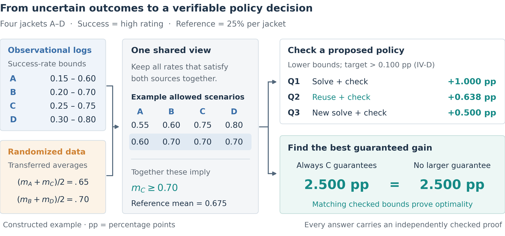
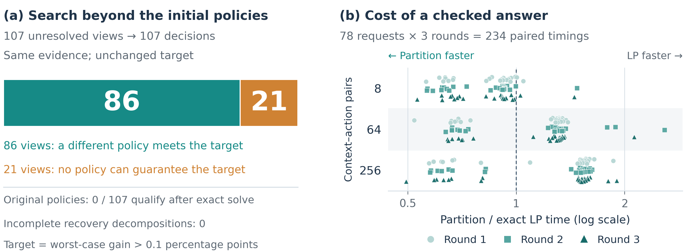
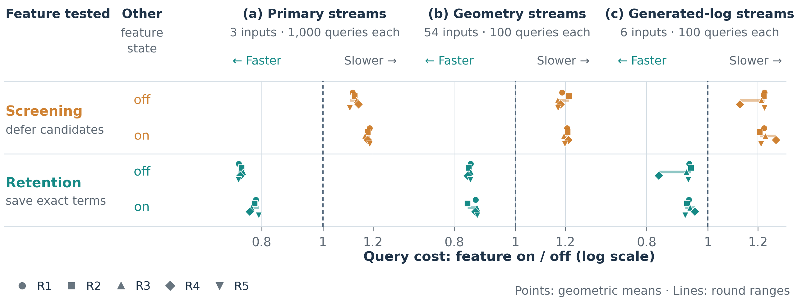

# Q-BRIDGE

Verifiable policy queries over joint confidence views.

[Manuscript](paper/Q-BRIDGE_ICDE2027.pdf) · [Overleaf project](Overleaf/ICDE2027_Overleaf.zip) · [Exact Coat policy case](examples/coat_policy_case/README.md) · [Historical artifact v5.2](https://github.com/yzd2002/Q-BRIDGE-ICDE2027/releases/tag/artifact-v5.2)

The manuscript distinguishes three questions: what the available information
certifies, whether a better policy exists outside a tested catalogue, and when
reusing checked evidence reduces query cost. Its Coat example provides an exact
policy and matching lower and upper certificates; the original catalogue
workload also records the cases where preprocessing does not pay.



The overview is a constructed four-action illustration. Its two branches distinguish checking one policy from certifying the best robust guarantee across a family. [All three vector figures, editable SVG files and reproducible drawing inputs](figure_assets/README.md) are included. The final 2026-11-11 readability edition reorganizes all three vector figures and five tables: concrete feasible scenarios, result-first family recovery, aligned feature comparisons, and grouped table headers. Figures use consistent sans-serif labels and navy/teal/orange colors. The text introduces the three-step algorithm before its derivation and distinguishes experimental units. Original measurements and displayed equations are retained; Table IV converts probability bounds to percentage points exactly. The Overleaf ZIP includes the complete current manuscript source.

**Material availability:** the v5.2 release is the published historical artifact.
The complete expanded archive for the current manuscript, including the later
family, execution and Coat workflow studies, is prepared locally but is not yet
published as a downloadable release. The repository contains the current manuscript and source, updated scientific code, and a runnable Coat case checking seven saved certificates against six independent requests. See [the source update index](SCIENCE_UPDATE_MANIFEST.json). This subset does not replace the complete archive or reproduce all measured timings.

## Experimental figures





All timing points and observed ranges are preserved. See the paper captions for the request counts, units and interpretation.

## Check one saved proof

With Git and Python 3.11+ installed:

```bash
git clone https://github.com/yzd2002/Q-BRIDGE-ICDE2027.git
cd Q-BRIDGE-ICDE2027
python3 -B -S icde2027/proof_check.py \
  --view examples/view.json \
  --proof examples/proof.json \
  --query examples/query.json
```

This check uses only the Python standard library and the cloned files. It needs
no full artifact download, optimizer or GPU. Success reports
`valid_lp_lower_bound` and `requested_query_checked` as true. The four-action
example is constructed: it checks a mathematical bound for the independently
supplied request, not scientific assumptions or the empirical study.

## Download the historical artifact

```bash
python3 -B -S download_artifact.py \
  --output ../qbridge-v5.2-download --extract
```

The downloader checks its pinned metadata, parts and assembled archive before
extraction. Follow the extracted package's README for its verification and
reproducibility instructions. This download remains v5.2 and excludes later
workflow evidence. No reviewer identity or usage tracking is required.
